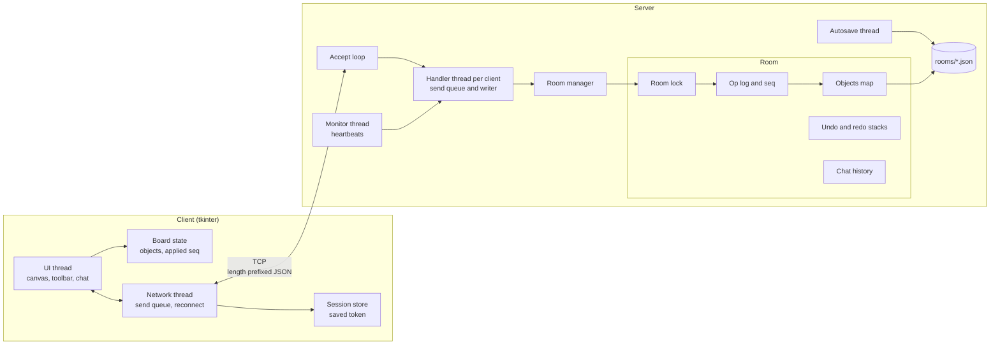
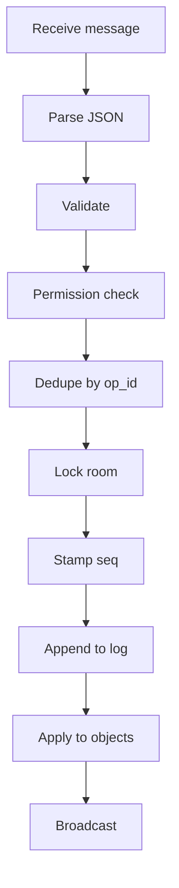
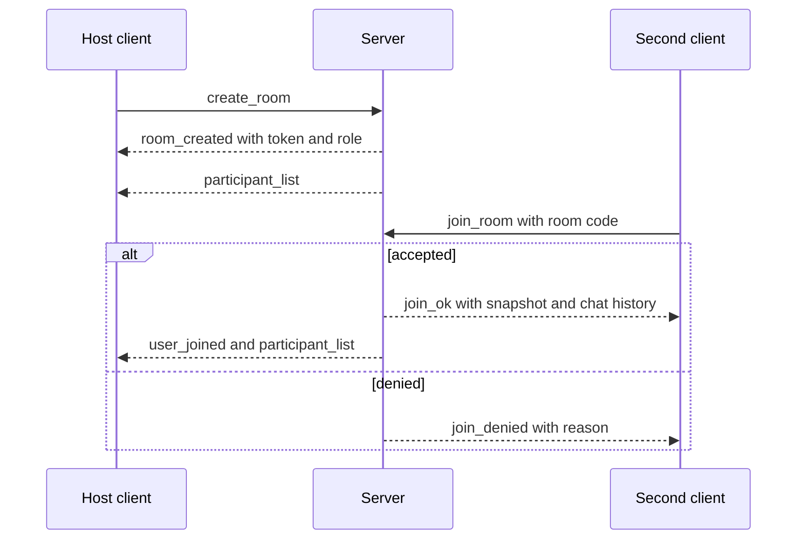
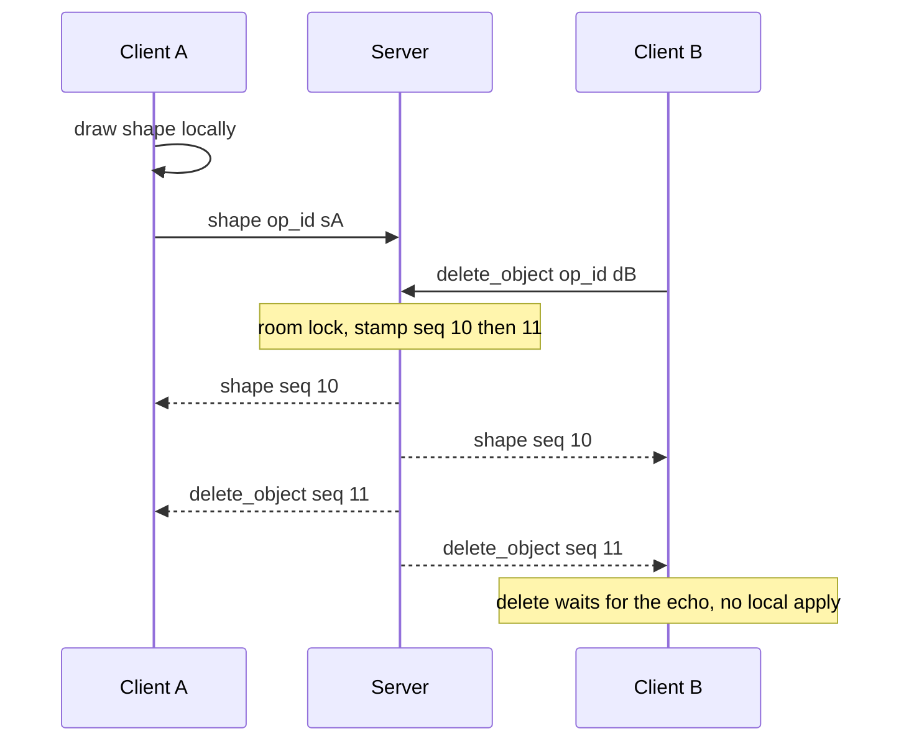
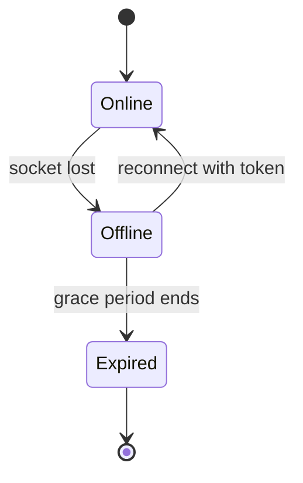
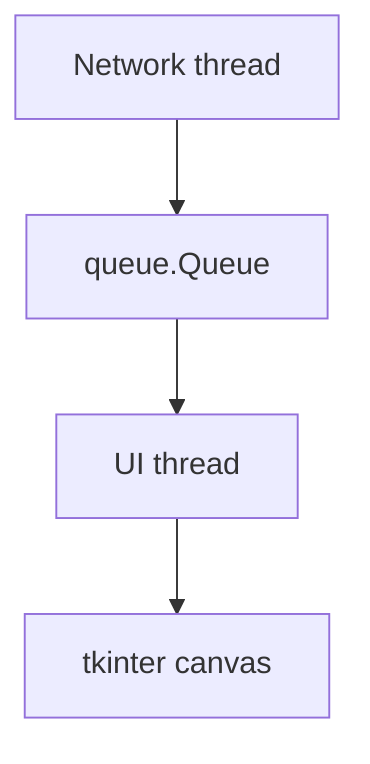

# InkLAN


A LAN-based collaborative whiteboard.

InkLAN is a server-based, multi-user whiteboard that works over a LAN using TCP sockets. One central server holds the truth; clients are thin views. Built as a Computer Networks lab project.

## Quick start

1. Unzip the release folder.
2. Run `allow_firewall.bat` as Administrator once.
3. Run `run_server.bat` and note the LAN IP and port.
4. Run `run_client.bat` on each machine, then create or join a room.

## Table of contents

- [Features](#features)
- [Screenshots](#screenshots)
- [Architecture](#architecture)
- [How it works](#how-it-works)
- [Tech stack](#tech-stack)
- [Wire protocol](#wire-protocol)
- [Roles and permissions](#roles-and-permissions)
- [Security](#security)
- [Getting started](#getting-started)
- [Using the app](#using-the-app)
- [Project structure](#project-structure)
- [Testing](#testing)
- [Building executables](#building-executables)
- [Documentation](#documentation)
- [Troubleshooting](#troubleshooting)
- [Known limitations and future work](#known-limitations-and-future-work)
- [Author](#author)

## Features

Drawing and shapes:
- Pen with color and width.
- Object eraser.
- 21 shape kinds through one shared geometry module.
- Text labels.
- Sticky notes with 5 preset colors, fixed 220x160 size, 300 character limit.
- Select tool to drag sticky notes.

Text and sticky notes:
- In-place text editor styled with the theme.
- Sticky notes render with wrapped text and the author name.
- Double-click edits a sticky note.
- Escape cancels an edit.

Collaboration:
- Shared canvas with logical 1600x900 coordinates.
- Remote cursors with name labels.
- Drawing indicators in the participant list.
- Chat with timestamps.
- Participant list with online and offline state.

Roles and security:
- Host, editor and viewer roles.
- Host controls: apply role, kick, remove offline slot, lock room.
- Server-side validation and role checks.

Consistency and recovery:
- Server assigned sequence numbers.
- Operation log and snapshots.
- Gap detection and resync.
- Reconnection with token and last_seq.
- Reserved names with grace period.
- Rejoin last room from a saved token.
- Autosave and empty room cleanup.

Persistence and export:
- Save and load boards as JSON.
- Export the board as PNG at 1x or 2x using Pillow.
- Fallback to PostScript if Pillow is missing.

## Screenshots

No screenshot PNGs are committed yet.

<!-- Expected screenshots:
01-connect.png
02-main-window.png
03-shapes-palette.png
04-board-stickies-text.png
05-participants-chat.png
06-host-controls.png
07-export.png
08-dark-theme.png
09-rejoin.png
10-reserved-name.png
-->

## Architecture



Clients connect to the server over TCP. The server owns room state and broadcasts stamped operations. TCP was chosen because the project needs reliable, ordered delivery. Rebuilding ordering and retransmission on UDP would add work without benefit on a LAN.

## How it works

### Operation pipeline



The server validates every message, checks the sender role, dedupes by op_id, locks the room, stamps the next seq, appends the op to the log, applies it to the object map, and broadcasts it to all clients in the room.

### Create and join a room



`join_room` can return `join_denied` for a bad code, wrong password, locked room, taken name or reserved name. On success the client receives a token, role, color, participants, snapshot, seq and chat history.

### Drawing and concurrent edit



Additive ops render locally right away and reconcile by op_id. Delete, undo, redo, clear, edit and move apply the server broadcast so the sender and every other client use the same path.

### Recovery



The client retries with backoff. On reconnect it sends the token and last_seq. The server returns ops_since or a snapshot. Reserved names show the remaining grace time.

### Client threading



Only the UI thread touches tkinter. The network thread pushes messages into a queue and the UI polls it with `root.after`.

## Tech stack

| Area | Technology | Used for |
|---|---|---|
| Language | Python 3.11+ | Server and client |
| Networking | socket, threading, struct, json | TCP framing and handlers |
| GUI | tkinter and ttk | Canvas, toolbar, panels |
| Image export | Pillow | PNG export |
| Packaging | PyInstaller | Standalone executables |
| Testing | pytest, pyflakes | Automated tests and static checks |
| Documentation | markdown | HTML report builder |

## Wire protocol

Frame: 4 bytes big endian length, then UTF-8 JSON. Limit: 1 MB.
```
+----------------+----------------------------+
| 4 bytes length | N bytes of UTF-8 JSON      |
| (big endian)   | N is at most 1 MB          |
+----------------+----------------------------+
```

Example, as sent by a client:

```json
{"type": "stroke_start", "op_id": "...", "stroke_id": "...",
 "tool": "pen", "color": "#000000", "width": 2, "x": 10, "y": 20}
```

The server stamps it and broadcasts the same message with `"seq": 1, "user": "alice", "ts": 1794050552.89` added.

Message groups:
- Connection and session: create_room, join_room, reconnect, leave, ping, pong, error.
- Participants: user_joined, user_left, user_disconnected, user_reconnected, kicked, participant_list, role_change, kick, remove_participant, lock_room, cursor_move.
- Drawing ops: stroke_start, stroke_points, stroke_end, shape, text, sticky, edit_object, move_object, delete_object, clear_canvas, undo, redo.
- State sync: snapshot, ops_since, resync_request, board_hash_request, board_hash.
- Chat: chat.
- Persistence: save_board, load_board, list_boards, boards_list.

Full details and validation limits are in `docs/protocol.md`.

## Roles and permissions

| Action | Host | Editor | Viewer |
|---|---|---|---|
| Draw and erase | yes | yes | no |
| Chat | yes | yes | yes |
| Clear canvas | yes | no | no |
| Save and load | yes | no | no |
| Kick | yes | no | no |
| Remove offline slot | yes | no | no |
| Lock room | yes | no | no |
| Change roles | yes | no | no |

## Security

- Room code plus optional password.
- Passwords use salted PBKDF2.
- Session tokens use `secrets.token_hex`.
- All validation is server side.
- Login attempts are rate limited.
- Ops are rate limited per client.
- Traffic is not encrypted. This is a LAN scope decision.

## Getting started

Prerequisites: Python 3.11 or newer. On Linux install tkinter: `sudo apt install python3-tk`.

From the release folder:
1. Run `allow_firewall.bat` as Administrator once.
2. Run `run_server.bat`.
3. Run `run_client.bat` on each machine.

From source on Windows:

```cmd
python -m venv .venv
.venv\Scripts\python.exe -m pip install -r requirements.txt
.venv\Scripts\python.exe server\main.py --host 0.0.0.0 --port 5050
.venv\Scripts\python.exe -m client.main
```

From source on Linux:

```sh
python3 -m venv .venv
.venv/bin/python -m pip install -r requirements.txt
.venv/bin/python server/main.py --host 0.0.0.0 --port 5050
.venv/bin/python -m client.main
```

The client has no command line options. The server options are:

- `--host` bind address, default `0.0.0.0`
- `--port` TCP port, default `5050`
- `--log-level` DEBUG, INFO, WARNING or ERROR
- `--heartbeat-interval` seconds between server pings, default `5.0`
- `--heartbeat-timeout` seconds of silence before disconnect, default `15.0`
- `--rooms-dir` directory for saved rooms, default `rooms`
- `--grace-period` seconds an offline user keeps their slot, default `120.0`
- `--empty-room-grace` seconds before an empty room is removed, default `5.0`
- `--autosave-interval` seconds between autosave scans, default `30.0`
- `--rate-limit` max ops per second per client, default `60.0`

Find the server LAN IP with `ipconfig` on Windows or `ip addr` on Linux. Open port 5050 in the firewall. Windows: `netsh advfirewall firewall add rule name="Whiteboard TCP 5050" dir=in action=allow protocol=TCP localport=5050`. Linux: `sudo ufw allow 5050/tcp`.

## Using the app

1. Start the server and note the IP and port.
2. Start the client and create a room or join with a code.
3. Draw with the pen, eraser, shapes, text and sticky notes.
4. Use undo and redo.
5. Save and load boards.
6. Export the board as PNG.
7. After a disconnect, use Rejoin last room.
8. Reserved names: wait or ask the host to remove your slot.

## Project structure

```
.
|-- protocol.py            framing and constants
|-- platform_utils.py      OS helpers
|-- shapes_geometry.py     shared shape geometry
|-- server/                main, client_handler, room, room_manager, auth, persistence
|-- client/                main, ui, net, state, tools, session_store, app_info
|-- tests/                 automated tests and smoke script
|-- docs/                  protocol, report, build guide, diagrams
|-- build/                 build and run scripts for Windows and Linux
|-- requirements.txt       runtime dependencies
|-- requirements-dev.txt   test and report tooling
```
## Testing

Commands:

```sh
python -m pytest -q
python -m pytest -q --runslow
python -m pyflakes client server protocol.py platform_utils.py tests shapes_geometry.py
```

The suites cover framing, rooms, canvas sync, convergence, reconnect, end-to-end connect, UI smoke, packaging and more.

As of 15 Nov 2026: 194 passed and 13 skipped by default, 207 passed with --runslow.

## Building executables

Run `build\build_all.bat` on Windows or `bash build/build_all.sh` on Linux. Each OS needs its own build. See `docs/build.md`.

## Documentation

- [Protocol](docs/protocol.md)
- [Technical report](docs/technical-report.md)
- [Design system](docs/design-system.md)
- [Build guide](docs/build.md)
- [Diagrams](docs/diagrams/)

## Troubleshooting

| Problem | What to do |
|---|---|
| Connection refused | Start the server and check the firewall |
| Timed out | Check the server IP and port |
| Wrong room code | Check the shared code |
| Wrong password | Check the password |
| Name reserved | Wait or ask the host to remove your slot |
| Firewall | Run the firewall helper as Administrator |
| SmartScreen or antivirus | Allow the executable |
| Missing tkinter on Linux | Install python3-tk |

## Known limitations and future work

- Traffic is not encrypted.
- Linux binaries and GUI are untested.
- Version history and presentation mode are not implemented.
- Image insertion is not implemented.
- Text uses one font family and long text is clipped.

## Author

Ankit Negi - https://github.com/ankitnegi-dev