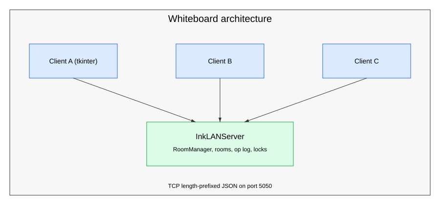
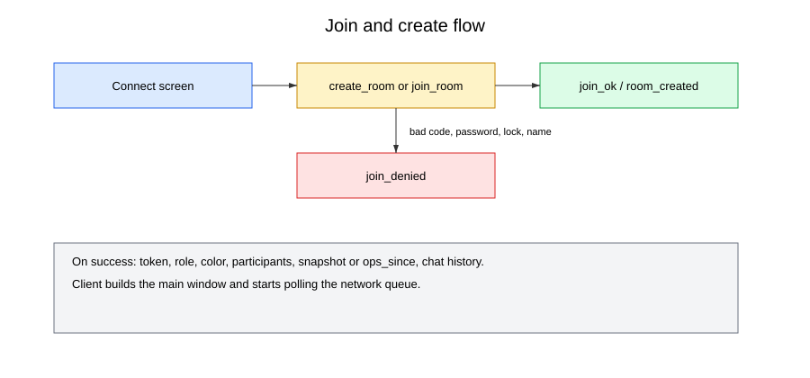
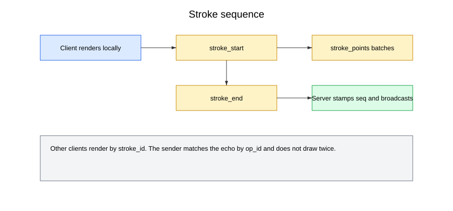
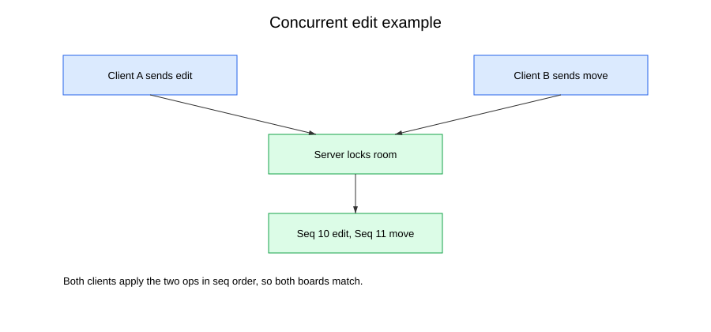
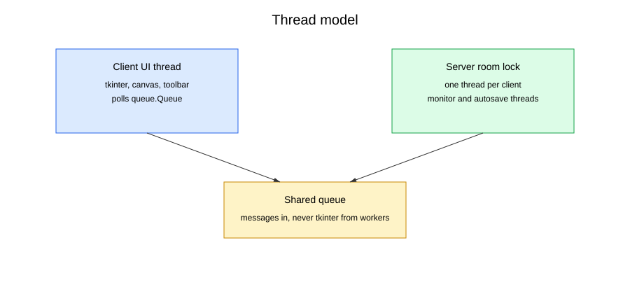
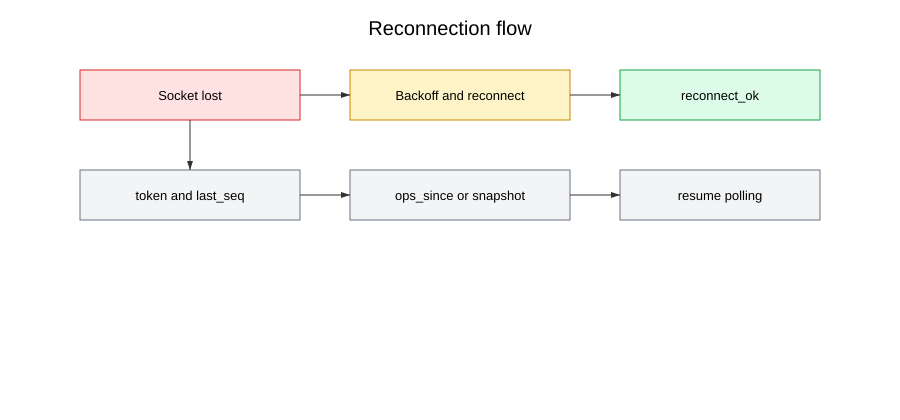

# InkLAN Technical Report

InkLAN: A LAN-based collaborative whiteboard.

## 1. Introduction and requirement mapping

| Requirement or rubric item | Feature | Module and function | Test |
|---|---|---|---|
| Drawing | Pen, eraser, shapes, text, sticky notes | `client/ui.py` `_on_press`, `_on_motion`, `_on_release`; `client/tools.py`; `shapes_geometry.py` | `tests/test_ui_smoke.py`, `tests/test_shape_drag.py`, `tests/test_sticky_ui.py` |
| Sync | Server assigned seq, op log, snapshots | `server/room.py` `apply_op`, `snapshot`, `ops_since` | `tests/test_canvas.py`, `tests/test_shapes.py` |
| Server coordination | Room manager, locks, broadcast | `server/room_manager.py`, `server/room.py`, `server/client_handler.py` | `tests/test_rooms.py`, `tests/test_reconnect.py` |
| Shared canvas | Logical 1600x900 coordinates | `client/tools.py`, `client/ui.py` `_to_logical`, `_to_window` | `tests/test_state.py`, `tests/test_ui_smoke.py` |
| Clear and persistence | clear_canvas, save, load, autosave | `server/room.py` `clear_canvas`, `server/persistence.py` | `tests/test_permissions_persistence.py`, `tests/test_autosave_cleanup.py` |
| Sessions | create_room, join_room, reconnect, grace period | `server/client_handler.py` `_handle_create_room`, `_handle_join_room`, `_handle_reconnect`; `client/ui.py` | `tests/test_reconnect.py`, `tests/test_reserved_name.py` |
| Participants | Participant list, roles, host controls | `server/room.py` `participant_list`, `client/ui.py` `_rebuild_participants` | `tests/test_ui_smoke.py` |
| Identification | Username, color, role | `server/auth.py`, `server/room.py` `next_color` | `tests/test_rooms.py` |
| Continuity | Reconnect, reserved names, rejoin last room | `server/client_handler.py`, `client/session_store.py` | `tests/test_reconnect.py`, `tests/test_reserved_name.py`, `tests/test_rejoin_ui.py` |
| Operation transmission | Framed JSON over TCP | `protocol.py` `send_msg`, `recv_msg` | `tests/test_framing.py` |
| Broadcasting | Per room broadcast | `server/room.py` `broadcast` | `tests/test_canvas.py` |
| Concurrent editing | Per room lock and op log | `server/room.py` `apply_op` | `tests/test_convergence.py` |
| Ordering and reliability | seq, dedupe, gap detection, resync | `server/room.py`, `client/state.py` `apply_op` | `tests/test_canvas.py`, `tests/test_reconnect.py` |
| Connection management | Heartbeat, monitor thread, grace period | `server/client_handler.py` `monitor_clients` | `tests/test_reconnect.py` |
| Chat | Chat log and broadcast | `server/room.py` `apply_chat`, `client/ui.py` `_append_chat` | `tests/test_canvas.py` |
| State representation | Object map by id | `client/state.py` `BoardState.objects` | `tests/test_state.py` |
| State sync | snapshot, ops_since, resync_request | `server/room.py`, `client/state.py`, `client/ui.py` | `tests/test_canvas.py`, `tests/test_reconnect.py` |
| Recovery | Reconnect, autosave, save and load | `server/persistence.py`, `client/ui.py` | `tests/test_autosave_cleanup.py`, `tests/test_reconnect.py` |
| Undo and redo | Per user stacks, undo and redo ops | `server/room.py` `undo`, `redo`; `client/ui.py` `_undo`, `_redo` | `tests/test_shapes.py`, `tests/test_sticky_notes.py` |
| Network architecture | TCP server and threaded handlers | `server/main.py`, `server/client_handler.py` | `tests/test_rooms.py`, `tests/test_reconnect.py` |
| Protocol design | Length prefixed JSON, validators | `protocol.py`, `server/room.py` `validate_op` | `tests/test_framing.py`, `tests/test_shapes.py` |
| UI | tkinter canvas, toolbar, panels | `client/ui.py` | `tests/test_ui_smoke.py`, `tests/test_toolbar_layout.py` |
| Performance | Batching, throttling, bounded queues | `client/ui.py`, `server/client_handler.py` | `tests/test_backpressure.py` |
| Concurrency | Locks, queues, monitor thread | `server/room.py`, `server/client_handler.py` | `tests/test_convergence.py` |
| Security | Passwords, roles, tokens, validation | `server/auth.py`, `server/room.py` `validate_op` | `tests/test_permissions_persistence.py`, `tests/test_rooms.py` |
| Platform | Windows and Linux scripts, platform_utils | `platform_utils.py`, `build/*.bat`, `build/*.sh` | `tests/test_packaging.py` |

## 2. System architecture

InkLAN has one authoritative server and many thin clients. Clients render an optimistic local view and reconcile with server broadcasts.

Figure 1: Clients connect to the server over TCP. The server owns room state and broadcasts stamped ops.
- `server/main.py`: argument parsing, socket bind, accept loop, monitor and autosave threads.
- `server/client_handler.py`: per client thread, read loop, dispatch table, join, reconnect, rate limiting, backpressure.
- `server/room.py`: room state, validation, op log, objects, chat, undo and redo.
- `server/room_manager.py`: room registry and cleanup.
- `server/auth.py`: salted password hashing and tokens.
- `server/persistence.py`: JSON save, load, autosave, empty room cleanup.
- `client` main entry point (start with `python -m client.main`)
- `client/net.py`: socket, send queue, receive loop.
- `client/state.py`: local board mirror and seq tracking.
- `client/ui.py`: canvas, toolbar, panels, rendering, export.
- `client/tools.py`: transforms, hit testing, shape constraints.
- `shapes_geometry.py`: shared shape geometry.
- `client/session_store.py`: saved reconnect tokens.

Threads:
- Server: one accept loop, one thread per client, one monitor thread, one autosave thread.
- Client: UI thread plus network thread. The network thread never touches tkinter. It puts messages in `queue.Queue`; the UI polls with `root.after`.

TCP was chosen because the project needs reliable, ordered delivery. Rebuilding ordering and retransmission on UDP would add work without benefit on a LAN. The protocol uses a 4 byte big endian length prefix followed by UTF-8 JSON.

### Socket communication

The server binds to the requested host and port with `SO_REUSEADDR`. The accept loop waits for connections with a short timeout so shutdown stays responsive. Each accepted connection starts a daemon thread. The server pings clients every 5 seconds by default and marks a client disconnected after 15 seconds of silence. A read timeout or a half open connection is treated as a disconnect. On shutdown the server saves all rooms and joins the monitor and autosave threads with a short timeout.

## 3. Application protocol

Framing: every message is `[4 bytes big endian unsigned length N][N bytes UTF-8 JSON]`. `MAX_MESSAGE_SIZE` is 1 MB. `recv_exact` loops until enough bytes arrive. Partial reads and coalesced reads are handled by that loop. Oversize lengths are rejected before the body is read.

The envelope is a JSON object with a `type` field. Server stamped ops also carry `seq`, `user`, and `ts`.

Message types implemented in code:

| Type | Direction | Key fields | Limits and notes |
|---|---|---|---|
| create_room | client to server | username, password? | username validated |
| room_created | server to client | room_code, token, role | host role |
| join_room | client to server | username, room_code, password? | password checked |
| join_ok | server to client | token, role, user_color, participants, snapshot, seq, chat_history | full state |
| join_denied | server to client | reason, message, remaining_grace? | reserved name includes countdown |
| reconnect | client to server | token, room_code, last_seq | resumes session |
| reconnect_ok | server to client | seq, snapshot or ops_since, participants | state catch up |
| reconnect_denied | server to client | reason, message | invalid or expired token |
| leave | client to server | none | clean leave |
| ping / pong | both | ts | heartbeat |
| error | server to client | code, message | rejection |
| user_joined, user_left, user_disconnected, user_reconnected, kicked | server to client | username, color, role | presence |
| participant_list | server to client | users | name, color, role, online, reserved_for |
| role_change | client to server | target, role | host only |
| kick | client to server | target | host only |
| remove_participant | client to server | target | host only, offline slot |
| lock_room | client to server | locked | host only |
| cursor_move | client to server / broadcast | x, y | throttled, not logged |
| stroke_start | client to server / broadcast | op_id, stroke_id, tool, color, width, x, y | tool pen or eraser |
| stroke_points | client to server / broadcast | op_id, stroke_id, points | max 500 points |
| stroke_end | client to server / broadcast | op_id, stroke_id | ends stroke |
| shape | client to server / broadcast | op_id, shape_id, kind, p1, p2, color, width, fill? | kind in SHAPE_KINDS |
| text | client to server / broadcast | op_id, obj_id, x, y, text, size, color | text 1 to 500, size 8 to 72 |
| sticky | client to server / broadcast | op_id, obj_id, x, y, text, color | text 1 to 300, 5 colors, fixed 220x160 |
| edit_object | client to server / broadcast | op_id, target_id, text | text 1 to 300, sticky only |
| move_object | client to server / broadcast | op_id, target_id, x, y | sticky only |
| delete_object | client to server / broadcast | op_id, target_id | object eraser |
| clear_canvas | client to server / broadcast | op_id | host only |
| undo / redo | client to server / broadcast | op_id | per user |
| snapshot | server to client | seq, objects, chat_tail | full state |
| ops_since | server to client | from_seq, ops | incremental sync |
| resync_request | client to server | last_seq | gap recovery |
| chat | client to server / broadcast | text | max 500 |
| save_board | client to server | name | host only |
| load_board | client to server | name | host only, broadcasts snapshot |
| list_boards | client to server | none | lists saved boards |
| boards_list | server to client | boards | saved board names |
| board_hash_request | client to server | seq, hash | consistency check |
| board_hash | server to client | seq, hash | consistency reply |

JSON examples:
- Stroke: `{"type":"stroke_start","op_id":"...","stroke_id":"...","tool":"pen","color":"#123456","width":2,"x":10,"y":20}`
- Shape: `{"type":"shape","op_id":"...","shape_id":"...","kind":"rectangle","p1":[1,2],"p2":[30,40],"color":"#123456","width":2,"fill":null}`
- Text: `{"type":"text","op_id":"...","obj_id":"...","x":5,"y":6,"text":"hello","size":12,"color":"#222222"}`
- Sticky: `{"type":"sticky","op_id":"...","obj_id":"...","x":10,"y":20,"text":"note","color":"#FFF2A8"}`
- Chat: `{"type":"chat","text":"hello"}`
- Join: `{"type":"join_room","username":"alice","room_code":"ABC123"}`
- Reconnect: `{"type":"reconnect","token":"...","room_code":"ABC123","last_seq":42}`
- Snapshot: `{"type":"snapshot","seq":42,"objects":[...],"chat_tail":[...]}`
- Resync: `{"type":"resync_request","last_seq":40}`

The eraser is an object eraser: it sends `delete_object`, not a stroke with tool eraser. `stroke_start` still allows tool values `pen` and `eraser` as defined in `TOOLS`, but the client eraser uses `delete_object`.

Figure 2: Create or join a room, then receive join_ok or join_denied.

## 4. Synchronization strategy

The server keeps an append-only op log. Each accepted op gets the next room seq. Clients apply ops in seq order. Clients render additive ops locally right away and reconcile by op_id. Delete, undo, redo, clear, edit and move are not applied locally as separate mutations; the sender waits for the server broadcast and applies it like every other client.

Snapshots contain seq, objects and chat_tail. Late joiners receive a snapshot. Reconnecting clients receive ops_since when the gap is small, otherwise a snapshot.

The client tracks applied_seq and latest_seq. If an op arrives ahead of the next expected seq, it buffers the op and sends resync_request. The client also computes a board hash and compares it with the server hash. If the seq matches but the hash differs, it logs a warning, shows "out of sync" and requests a snapshot.

Figure 3: A stroke is rendered locally, sent in batches, stamped by the server, and broadcast to other clients.

Worked example with real seq values:

- Start: both clients have applied seq 4.
- User A sends a stroke. The server stamps it seq 5 and broadcasts it. Both clients apply seq 5. Both show stroke A.
- User B sends a stroke. The server stamps it seq 6. Both clients apply seq 6. Both show stroke A and stroke B.
- User A erases B's stroke. The server stamps `delete_object` seq 7. Both clients remove B's stroke.
- User A undoes her own stroke. The server stamps undo seq 8 with action `remove_stroke`. Both clients remove A's stroke.
- After these four steps both boards are empty and both have applied seq 8.

Optimistic apply is used for additive ops so the local user sees no delay. Delete, undo, redo, clear, edit and move are applied from the server broadcast so the sender and all other clients use the same path and converge.

Figure 4: Two clients edit at the same time. The server assigns seq 10 and 11; both clients apply them in that order.

## 5. Concurrency handling

- Each room has a `threading.Lock`.
- `apply_op` validates, dedupes by op_id, increments seq, appends to the log, and updates objects inside that lock.
- Each client has a send queue and writer thread. Broadcasts do not block the room on a slow client.
- A single monitor thread scans all clients for heartbeat timeouts.
- Backpressure: if a client's send queue overflows, it is put in resync mode and later resyncs.
- Rate limiting: ops are limited per client per second.
- Client rule: only the UI thread touches tkinter. The network thread pushes messages into `queue.Queue`; the UI polls with `root.after`.

### Thread model

Figure 5: UI thread and network thread on the client; room lock, client threads, monitor thread and autosave thread on the server.

## 6. Ordering, duplicate and missing update handling

- Only the server assigns seq.
- op_id (UUID) is used for deduplication on both sides.
- The client detects gaps when seq is greater than applied_seq + 1.
- On a gap, the client buffers the op and sends resync_request(last_applied_seq).
- The server replies with ops_since or a snapshot.
- Delayed ops are applied at their stamped position.
- Duplicate ops are ignored.

| Failure case | Client action | Server action | Test |
|---|---|---|---|
| Duplicate op | ignore by seq | ignore by op_id | `tests/test_shapes.py` |
| Op out of order | buffer and resync | ops_since or snapshot | `tests/test_reconnect.py` |
| Missing op | gap detection | ops_since or snapshot | `tests/test_reconnect.py` |
| Delayed op | applied at stamped seq | seq stamping | `tests/test_canvas.py` |
| Lost reconnect | reconnect with token and last_seq | reconnect_ok | `tests/test_reconnect.py` |

## 7. Undo and redo semantics under concurrency

Rules:
- Undo is per user.
- A stroke is one undoable unit.
- Undo is logged as a new op, so all clients stay in sync.
- Redo re-applies the last undone op.
- A new drawing action clears the redo stack.
- If another user deleted the target, undo is a no-op with a notice.
- clear_canvas can be undone by the host.

| Case | Result |
|---|---|
| Undo own stroke | stroke removed on all clients |
| Undo deleted object | no-op, notice shown |
| Undo clear | cleared objects restored |
| Redo after new action | redo stack cleared |
| Undo another user's object | not allowed; undo is per user |

## 8. Recovery mechanisms

- Heartbeat: server pings every 5 seconds by default; 15 seconds of silence marks a client disconnected.
- Disconnected users stay offline for a configurable grace period (default 120 seconds).
- Tokens are issued on join and used for reconnect.
- reconnect validates the token and restores username, color, role and undo stacks.
- A second connection with the same token replaces the first socket.
- Reserved names: a name belonging to an offline user is reserved for the grace period. The join denial includes remaining seconds.
- The host can remove an offline slot immediately. This does not block a later reconnect with a valid token.
- The client saves the last session token in the user config folder and offers Rejoin last room.
- Autosave runs on an interval and saves dirty rooms.
- Save and load write and read JSON board files.
- Empty rooms are saved and removed after a grace period.
- If the host leaves, the room remains until the empty-room grace expires.

Figure 6: Socket loss, backoff, reconnect with token and last_seq, then state catch-up.

## 9. Security and access control

- Room code plus optional password.
- Passwords use PBKDF2 with a salt.
- Session tokens use `secrets.token_hex`.
- Roles: host, editor, viewer.
- Viewers cannot draw or delete.
- Only the host can clear, save, load, kick, change roles, lock the room, and remove offline slots.
- Login attempts are rate limited.
- All validation is server side.

Traffic is not encrypted. This is a LAN scope decision and is stated plainly.

## Performance

## 10. Testing

Date of this report: 15 Nov 2026.

Counts from the current suite:
- Default run: `194 passed, 13 skipped in 169.75s (0:02:49)`
- Full run: `207 passed in 195.67s (0:03:15)`

Test files and coverage:
- `tests/test_framing.py`: framing.
- `tests/test_rooms.py`: rooms and participants.
- `tests/test_canvas.py`: drawing, sync, resync.
- `tests/test_state.py`: client state and coordinates.
- `tests/test_tools.py`: tool helpers.
- `tests/test_ui_smoke.py`: headless UI.
- `tests/test_ui_connect.py`: connect mode.
- `tests/test_reconnect.py`: reconnect, grace, monitor.
- `tests/test_autosave_cleanup.py`: autosave and cleanup.
- `tests/test_backpressure.py`: queue overflow.
- `tests/test_shapes.py`: shapes and text.
- `tests/test_shape_drag.py`: shape drag and preview.
- `tests/test_item_cleanup.py`: canvas item cleanup.
- `tests/test_sticky_notes.py`: sticky validation and sync.
- `tests/test_sticky_ui.py`: sticky UI.
- `tests/test_png_export.py`: PNG export.
- `tests/test_erase_both.py`: erase convergence and board hash.
- `tests/test_erase_real_events.py`: real eraser events.
- `tests/test_convergence.py`: scripted and random convergence.
- `tests/test_connect_e2e.py`: real connect flow.
- `tests/test_connect_guard.py`: connection threads.
- `tests/test_network_client_attrs.py`: network client attributes.
- `tests/test_reserved_name.py`: reserved names.
- `tests/test_rejoin_ui.py`: rejoin UI.
- `tests/test_session_store.py`: token store.
- `tests/test_toolbar_layout.py`: toolbar layout.
- `tests/test_keyboard_shortcuts.py`: keyboard shortcuts.
- `tests/test_error_reporting.py`: error deduplication.
- `tests/test_permissions_persistence.py`: permissions and persistence.
- `tests/test_packaging.py`: packaging static checks.
- `tests/test_static_checks.py`: static checks.

Manual checks:
- Windows executable build and run were checked.
- Linux binaries and GUI were not tested on Linux.
- Two physical machines were not tested in this environment.

## 11. Known limitations and future work

- History and presentation mode are not implemented.
- Linux binaries and the GUI on Linux are untested.
- Traffic is not encrypted.
- The suite takes about 3 minutes for the full run.
- Text uses one font family and clips long text.
- Undo of a deleted target is a no-op with a notice.

## 12. User guide

1. System requirements: Python 3.11+ for source, or the packaged Windows executables.
2. Packaged release: run `allow_firewall.bat` as administrator, then `run_server.bat`, then `run_client.bat` on each machine.
3. From source on Windows: create a venv, install requirements, run `python server/main.py` and `python -m client.main`.
4. From source on Linux: install `python3-tk`, create a venv, install requirements, run the same commands.
5. Find the server LAN IP with `ipconfig` on Windows or `ip addr` on Linux.
6. Open port 5050 in the firewall. Windows: `netsh advfirewall firewall add rule name="InkLAN" dir=in action=allow protocol=TCP localport=5050`. Linux: `sudo ufw allow 5050/tcp`.
7. Start the server. Options include `--host`, `--port`, `--rooms-dir`, `--grace-period`, `--autosave-interval`, and `--rate-limit`.
8. Create a room in the client. Share the room code and optional password.
9. Join with server IP, port, username and room code.
10. Use pen, eraser, text, select, sticky, shapes, color, width, fill, text size, undo, redo, clear, save, load and export.
11. The participant list shows names, colors, roles and online state. Hosts can apply roles, kick, remove offline slots and lock the room.
12. Chat is in the right panel.
13. After a disconnect, the client retries with backoff. Use Rejoin last room to restore the session.
14. Reserved names: if your name is reserved, wait or ask the host to remove your slot.
15. Troubleshooting: connection refused means the server is not running or the firewall blocks it; timed out means the wrong IP or port; wrong room code or password means check the shared code; name reserved means wait or rejoin; SmartScreen or antivirus may require allowing the executable.

## 13. Appendix

Screenshot placeholders:
1. `01-connect.png` - Connect screen.
2. `02-main-window.png` - Main window with toolbar.
3. `03-shapes-palette.png` - Shapes palette.
4. `04-board-stickies-text.png` - Board with stickies and text.
5. `05-participants-chat.png` - Participant list and chat.
6. `06-host-controls.png` - Host controls.
7. `07-export.png` - Export dialog.
8. `08-dark-theme.png` - Dark theme.
9. `09-rejoin.png` - Rejoin button.
10. `10-reserved-name.png` - Reserved name message.

Repository layout:
- `protocol.py`
- `server/`
- `client/`
- `tests/`
- `docs/`
- `build/`
- `shapes_geometry.py`

Rebuild: see `docs/build.md`.

SVG diagrams are in `docs/diagrams/`: `architecture.svg`, `join-flow.svg`, `stroke-sequence.svg`, `reconnection-flow.svg`, `concurrent-edit.svg`, `thread-model.svg`. They are embedded in the HTML version.
